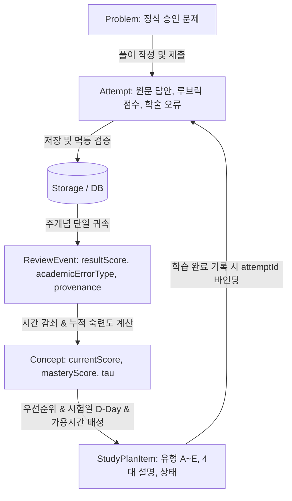

# Plan 04 — 01. 복습 엔진 전수 진단 및 데이터 흐름 분석 (Review Engine Audit)

## 1. 개요 및 진단 배경
LearnAway는 대학 전공 시험(수학·통계·CS 등)을 대비하는 적응형 간격 반복(Spaced Repetition) 학습 도구이다.
Plan 03에서 구축된 학술 오답 분류 체계(9대 범주, 이원화 평가, 출처 추적)를 바탕으로, 본 감사는 기존 복습 엔진 및 스케줄러가 학생의 실제 풀이 기록(`Attempt`), 평가 결과, 복습 이벤트(`ReviewEvent`), 개념 상태(`Concept`), 학습 계획(`StudyPlanItem`)으로 이어지는 파이프라인 전반을 전수 점검하였다.

---

## 2. 기존 복습 엔진의 주요 결함 및 위험 요인

### 결함 1: 숙련도(Mastery)와 기억 유지율(Retention)의 혼동 및 단일 점수 종속
- **원인**: 과거 구현은 `concept.currentScore`라는 단일 수치로 두 가지 이질적인 학습 상태를 동시에 표현함.
  - 망각 곡선 감쇠: $R(t) = S_0 (1 + t/\tau)^{-\alpha}$에 의해 시간이 지나면 점수가 급격히 하락함.
  - 학생이 과거 100점으로 증명을 마쳤더라도 14일이 경과하면 `currentScore`가 30점대로 하락하여, 시스템이 학생의 "이해 수준(Mastery)" 자체를 미학습자 수준으로 오판함.
- **영향**:
  - 이미 높은 수준의 개념 이해를 보유한 학생에게 불필요하게 기초 정의 및 단순 단답 문항만을 계속 재출제하는 퇴행적 학습 경로 발생.
  - 반대로 최초 1회 100점을 맞고 당일에는 유지율이 높아 숙련된 것으로 오인되어 전이·복합 문제로 급격히 월반하는 부작용.
- **수정**:
  - `retentionScore`(현재 회상 확률, 0~100)와 `masteryScore`(누적 개념 숙련도, 0~100)를 엄격히 분리.
  - 하위 호환성을 위해 `currentScore`는 `retentionScore`를 반영하되, 모든 추천 및 일정 알고리즘은 두 축을 독립적인 차원으로 결합 평가하도록 개선.

### 결함 2: 단순 계산 실수와 개념적 결손의 동일 취급
- **원인**: 풀이 점수가 70점일 때, 감점의 원인이 "부등호 단순 오타(`CALCULATION_ERROR`)"인지, "정리의 전제조건 누락 및 개념적 혼동(`CONCEPT_MISUNDERSTANDING`)"인지 구분하지 않고 동일하게 감점 처리.
- **영향**:
  - 대학 수학/통계 시험에서 계산 실수는 흔히 발생하나 개념적 이해는 완벽한 경우가 많음. 이를 개념 결손으로 취급하여 기초 개념 복습으로 강제 강등시키는 오류 발생.
- **수정**:
  - `calculateConceptMasteryScore`에서 `CALCULATION_ERROR`는 숙련도 감점 팩터를 1.0(비감점)으로 유지하고 오답 원인 분석만 기록.
  - `CONCEPT_MISUNDERSTANDING`, `FORMULA_MISAPPLICATION` 발생 시에만 개념 숙련도 감점 팩터(0.85) 및 반복 오답 페널티(-3점)를 적용.

### 결함 3: 복합 개념(Multi-concept) 문제 풀이 시 부개념 허위 이벤트 위조 위험
- **원인**: 복합 문제가 개념 A, B를 모두 포함할 때, 풀이 결과를 두 개념 모두에 무조건 복제 저장할 경우, 전체 문항 점수가 개별 부개념의 점수로 왜곡되는 점수 팽창(Score Inflation) 위험 존재.
- **영향**:
  - 개념 B에 대한 세부 평가 없이 만점 또는 오답이 B에 전파되어, B의 복습 일정이 비정상적으로 왜곡됨.
- **수정**:
  - Stage 4 및 Stage 10 아키텍처 불변 조건에 따라, 풀이 `Attempt`의 `ReviewEvent`는 주개념(`conceptId`)에만 단일 귀속(Whole-item Attribution)하고 부개념(`conceptIds`)은 참조 맥락으로만 보존.

### 결함 4: 불확실한 AI 평가(`UNCERTAIN` / `needsReview`)의 실제 오답 오인
- **원인**: AI 채점기가 신뢰도 부족, 파싱 불완전, 또는 학생의 특이 증명 방식으로 인해 `needsReview: true` 또는 `academicErrorType: 'UNCERTAIN'`으로 플래그를 지정했음에도 불구하고, 낮은 점수가 그대로 학생의 학습 이력에 확정 반영됨.
- **영향**:
  - AI 평가 오류가 학습자의 실제 실력 저하로 둔갑하여 사용자 신뢰 훼손.
- **수정**:
  - `calculateConceptMasteryScore`에서 `acError === 'UNCERTAIN' || ev.needsReview`인 이벤트는 기존 베이스라인 점수를 보존(`Math.max(rawScore, baseScore ?? 70)`)하여 확정적 강등을 방지.

### 결함 5: 선수 개념(Prerequisite) 의존성 순환(Cycle) 시 무한 재귀 및 스택 오버플로 위험
- **원인**: 사용자가 설정하거나 AI가 추출한 개념 간 선수 관계에 순환 참조(A $\to$ B $\to$ A)가 존재할 경우, 선수 개념의 위험도를 탐색하는 함수가 무한 재귀에 빠질 위험.
- **수정**:
  - `calculatePrerequisiteDependencyRisk`에 `visited: Set<string>` 기반 사이클 탐지 메커니즘을 적용하여 1회 방문한 개념은 즉시 스킵하도록 방어 구현.

---

## 3. 데이터 흐름(Data Flow) 전수 추적

LearnAway의 학습 및 복습 라이프사이클은 다음의 단방향 불변 흐름을 유지한다:

1. **Problem $\to$ Attempt**:
   - 학생의 실제 답안, 루브릭 평가 결과(부분점수, 증거 인용), 9대 학술 오답 유형(`academicErrorType`), 원문 스냅샷이 불변으로 고정됨.
2. **Attempt $\to$ ReviewEvent**:
   - 동일 Attempt ID 제출 시 `already_completed`를 반환하는 멱등성 보장.
   - 복합 문제의 경우 주개념(`conceptId`)에만 ReviewEvent를 생성하여 점수 왜곡 방지.
3. **ReviewEvent $\to$ Concept**:
   - `calculatePowerLawRetention`: 경과 시간에 따른 순수 기억 유지율 감쇠 산출.
   - `calculateConceptMasteryScore`: 평가 점수, 부분점수, 오류 유형, 힌트 감점을 반영한 누적 숙련도 산출.
4. **Concept $\to$ StudyPlanItem**:
   - 일일 가용 학습 시간(예: 60분) 초과 배정 원천 차단.
   - 시험 D-Day 구간(D-14 이상: 기초·간격반복, D-3~13: 취약개념 집중, D-0~2: 핵심회상)에 따른 맞춤형 문제 유형(유형 A~E) 추천.
   - 4대 규칙 기반 설명(`explanationDetails`) 동시 생성.
