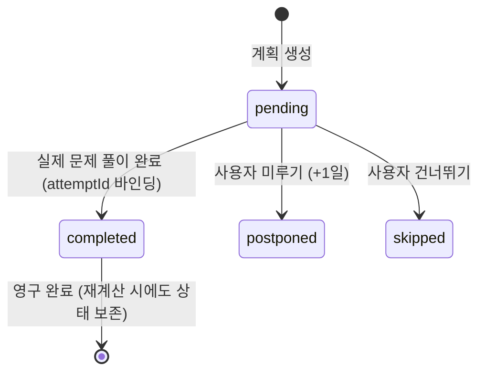

# Plan 04 — 05. 학습 데이터 무결성 및 동시성 제어 (Data Integrity & Concurrency)

## 1. 개요 및 핵심 불변 데이터 모델
LearnAway의 복습 및 평가 파이프라인은 5대 핵심 엔티티 간의 엄격한 참조 무결성을 기반으로 한다:

```
Problem (정식 승인 문항)
  └── Attempt (학생 제출 답안 및 루브릭 평가 스냅샷)
        └── ReviewEvent (개념 이력에 불변 기록되는 학습 사건)
              └── Concept (누적 숙련도, 망각곡선 및 기억안정성 상태)
                    └── StudyPlanItem (일자별 학습 계획 항목)
```

어떠한 네트워크 재시도, 다중 탭 동시 접속, 사용자 계정 전환 상황에서도 이 체인의 일관성이 왜곡되어서는 안 된다.

---

## 2. 멱등성(Idempotency) 및 중복 저장 원천 방지

### A. 동일 Attempt 중복 저장 차단
- `storage.recordAttemptAndUpdateConcept(attempt)`:
  - 이미 저장된 Attempt ID가 감지될 경우, 신규 Attempt 추가 및 점수 재계산을 수행하지 않고 `{ status: 'already_completed' }`를 즉시 반환.
  - 중복 네트워크 요청이나 더블 클릭으로 인해 학생의 풀이 횟수나 점수가 두 번 반영되는 현상 완전 방지.

### B. 동일 ReviewEvent 중복 바인딩 차단
- 각 `ReviewEvent`는 생성 시 고유의 `attemptId`를 영구 보존.
- 개념(`Concept.events`) 순회 시 `targetConcept.events.some(e => e.attemptId === effectiveAttempt.id)` 검사를 통과한 경우에만 신규 이벤트를 추가.
- 복구(Recovery) 또는 재시도 시에도 이미 연결된 ReviewEvent가 중복 삽입되지 않음.

### C. 복합 개념 문항의 전체 귀속(Whole-Item Attribution) 원칙
- 복합 문제(`Problem.conceptIds: ['c1', 'c2']`)의 풀이 기록:
  - 주개념(`effectiveAttempt.conceptId`)에만 정규 ReviewEvent 1건을 생성.
  - 부개념(`c2`)에는 점수가 분할되거나 허위 복제되지 않도록 원천 차단하여, 부개념의 독립적 기억 유지율과 숙련도가 왜곡되지 않도록 보호.
  - 부개념 ID들은 Attempt의 메타데이터(`conceptIds`)로 안전하게 보존되어 향후 분석 시 전체 문항 단위로 추적 가능.

---

## 3. 계획 항목(`StudyPlanItem`) 상태 전이 및 완료 보존



1. **허위 완료 방지 (No Fake Completion)**:
   - 신규 생성된 계획 항목은 반드시 `status: 'pending'`으로 시작.
   - 학생이 실제로 문제를 풀고 `Attempt`가 정상 생성되어 유효한 `attemptId`가 전달될 때만 `status: 'completed'`로 전이.
2. **재계산 시 완료 기록 불변성 (Immutability across Recalculations)**:
   - 학생이 목표 시간을 바꾸거나 시험일을 연기하여 스케줄러가 전체 일정을 재계산하더라도:
     - 이미 완료된 항목(`completedAt` 존재)은 완료 당일의 시간 슬롯에 그대로 보존.
     - 가용 시간 계산 시에도 이미 완료한 항목의 소요 시간(`estimatedMinutes`)을 당일 사용 시간으로 정확히 산입.

---

## 4. 다중 탭 및 계정 격리 (Account Isolation)

1. **계정 전환 시 로컬 스토리지 키 격리 (`storageScope.ts`)**:
   - `auth_user_id`를 프리픽스로 사용하여 사용자 A의 학습 기록과 사용자 B의 학습 기록이 브라우저 로컬 스토리지 상에서 완전 분리.
   - 게스트 모드 $\to$ 간편 가입 전환 시에는 안전한 마이그레이션 파이프라인을 통해서만 이관 수행.
2. **AI 평가 실패의 학습 실패 오인 방지**:
   - AI Gateway 호출 실패, 503 에러, 또는 JSON 파싱 실패 시, 이를 "0점 오답 Attempt"로 기록하지 않고 에러 상태로 반환.
   - 학생의 실제 풀이 답안 텍스트는 로컬 임시 초안에 안전하게 보존되어 재시도할 수 있도록 지원.
