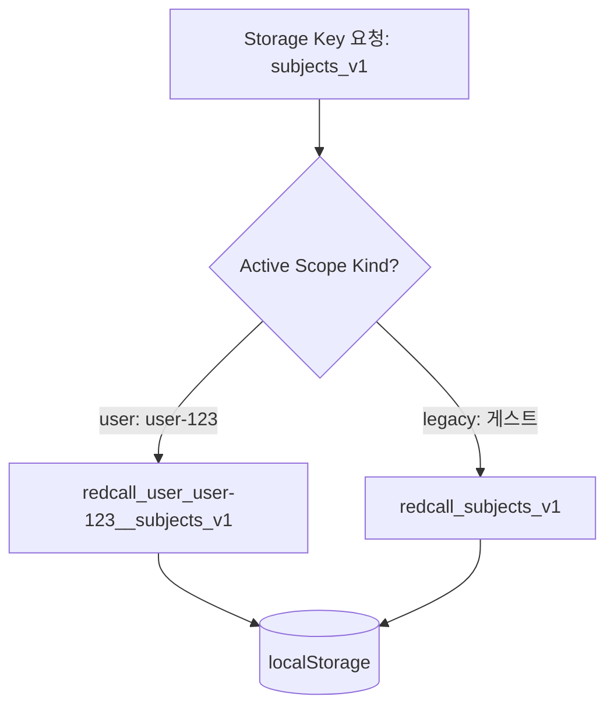

# Plan 05 — 01. 저장소 진단 및 단일 진실 공급원(SoT) 무결성 체계 (Storage Audit & SoT Integrity)

## 1. 개요 및 배경
LearnAway는 대학 시험 대비를 위해 학생의 과목, 강의자료, 개념 체계, 문제, 풀이 답안(`Attempt`), 루브릭 채점 결과, 복습 이벤트(`ReviewEvent`), 학습 계획(`StudyPlanItem`)을 다룬다.
이러한 학습 데이터는 학생의 시험 성적과 직결되므로, 브라우저 스토리지 할당량 초과(QuotaExceededError), 네트워크 단절, 비정상 JSON 손상, 계정 전환 등의 예외 상황에서도 데이터 유실(Data Loss)이나 과거 이력 왜곡이 절대 발생해서는 안 된다.

본 문서는 LearnAway의 다층 저장소 구조를 진단하고, 단일 진실 공급원(Source of Truth, SoT) 원칙과 로컬 스토리지 무결성 검증 체계를 명확히 규정한다.

---

## 2. 저장소 구조 및 단일 진실 공급원(SoT) 원칙

LearnAway는 오프라인 가용성과 서버 영속성을 결합한 하이브리드 아키텍처를 채택하고 있다:

| 계층 | 대상 데이터 | 역할 및 신뢰 등급 | 지속성 |
| :--- | :--- | :--- | :--- |
| **Supabase Cloud DB** (PostgreSQL) | 과목, 자료 메타데이터, 개념, 문제, 풀이(`attempts`), 채점, 복습 이벤트 | **권위적 진실 공급원 (Authoritative SoT)** | 영구 영속화 (RLS 보호) |
| **IndexedDB** | 대용량 강의자료 원문(`material_bodies`), 복구 스냅샷 | 로컬 대용량 캐시 및 영속 저장소 | 브라우저 영구 보존 |
| **localStorage** | 로컬 캐시, UI 설정, 미저장 초안(`drafts`), 동기화 메타 | 오프라인 읽기 캐시 및 변경 스테이징 | 브라우저 보존 (5MB 한도) |
| **inMemoryStore** | 스토리지 에러 시 임시 버퍼 | 장애 격리용 비상 버퍼 | 세션 생명주기 |

### 2.1 단일 진실 공급원 (SoT) 불변 규칙
1. **서버 검증 최우선**: 서버 저장 확인 응답(`200 OK`)을 수신하기 전까지는 클라이언트에서 "동기화 완료" 상태로 표시하지 않는다.
2. **과거 풀이 불변성 (Attempt Immutability)**: 제출 완료된 `Attempt`의 문제 본문, 학생 답안, 루브릭 평가 점수, 학술 오답 유형은 문제의 수정이나 루브릭 개정에 의해 소급 변경되지 않는다.
3. **초안과 확정의 엄격 분리**: 작성 중인 답안과 생성 중인 문제 초안은 `draft_id`를 통해 분리되며, 검증 및 제출 전까지는 정식 학습 기록 집계에 포함되지 않는다.
4. **조회 실패 시 빈 데이터 치환 금지**: 네트워크 일시 오류나 RLS 권한 조회 실패를 빈 데이터(`[]`)로 취급하여 기존 캐시나 서버 데이터를 덮어쓰지 않는다.

---

## 3. 계정 격리 네임스페이스 (Storage Scoping)

서로 다른 사용자가 한 기기에서 브라우저를 공유할 때 데이터가 혼입되는 것을 원천 차단하기 위해, 모든 스토리지 키는 `lib/storageScope.ts`를 통해 계정별 네임스페이스로 격리된다:



- **격리 접두사**: `redcall_user_<encodeURIComponent(userId)>__<baseKey>`
- **레거시/게스트 접두사**: `redcall_<baseKey>`
- **교차 스코프 읽기 차단**: `isKeyInActiveScope(rawKey)`를 통과하지 않는 키는 순회 및 동기화 대상에서 배제된다.

---

## 4. 데이터 무결성 검증 체계 (`checkStoredDataIntegrity`)

스토리지 내 데이터의 비정상 손상(잘린 JSON, 브라우저 비정상 종료로 인한 파편화, 스키마 불일치)을 선제적으로 감지하기 위해 `checkStoredDataIntegrity()` 함수를 구현하였다.

### 4.1 스키마 형상 검증 규칙 (`STORED_VALUE_SHAPES`)
- `subjects_v1`: Array Records (필수 필드: `id`)
- `materials_v1`: Array Records (필수 필드: `id`, `subjectId`)
- `concepts_v1`: Array Records (필수 필드: `id`, `subjectId`)
- `problems_v1`: Array Records (필수 필드: `id`, `subjectId`)
- `attempts_v1`: Array Records (필수 필드: `id`)
- `mock_exam_sessions_v1`: Array Records (필수 필드: `id`)
- `study_plan_items_v1`: Array Records (필수 필드: `id`)
- `retention_settings_v1`: Object
- `study_plan_settings_v1`: Object

### 4.2 손상 발생 시 복구 전략
```typescript
const integrity = checkStoredDataIntegrity();
if (!integrity.ok) {
  // 1. 손상된 키(failedKeys)를 식별하여 화면에 경고 알림 표시
  // 2. 정상 데이터를 빈 배열로 덮어쓰지 않고 서버 동기화 캐시에서 복원 시도
  // 3. 복원 불가 시 사용자에게 JSON 내보내기 및 재시도 경로 제공
}
```

---

## 5. 할당량 초과 및 삭제 묘비 (Tombstone) 메커니즘

### 5.1 `QuotaExceededError` 무중단 격리
브라우저 스토리지 5MB 한도 초과 시에도 애플리케이션 크래시를 방지하고 메모리 버퍼(`inMemoryStore`)로 자동 격리한다:
- `safeSetItem`은 Quota 에러 발생 시 예외를 전파하지 않고 `false`를 반환하며 메모리 백업 버퍼에 보존.
- 사용자가 불필요한 강의자료를 정리할 수 있도록 저장 실패 알림을 표시.

### 5.2 삭제 묘비 (`deleted_material_ids_v1`)
오프라인 상태에서 삭제된 자료가 네트워크 복구 후 구형 서버 스냅샷 수신 시 부활(Resurrection)하는 문제를 방지하기 위해 삭제 묘비 메커니즘을 적용한다:
- 자료 삭제 시 `deleted_material_ids_v1` 레지스트리에 묘비 ID 기록.
- 서버 캐시 또는 복원 파일에 해당 ID가 포함되어 있어도 명시적으로 제외 처리.
- 서버 동기화 확인 시에만 묘비 레코드 정리.
