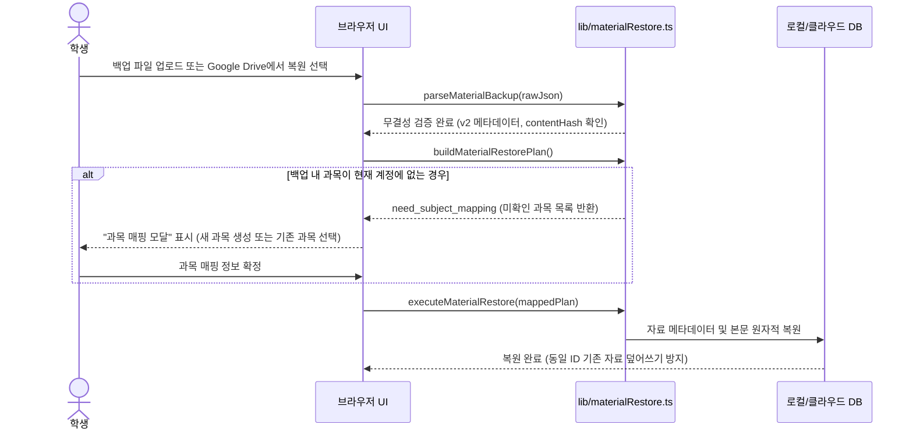

# Plan 05 — 03. Google Drive 백업/복원 및 무결성 검증 체계 (Google Drive Backup, Restore & Integrity Verification)

## 1. 개요 및 목적
학생이 수개월 동안 업로드한 대용량 강의자료(PDF, Markdown)와 정밀하게 구축된 개념·문제 데이터는 기기 분실, 브라우저 캐시 삭제, 또는 계정 이전 시에도 안전하게 보호되어야 한다.
LearnAway는 Google Drive API 연동 백업 및 로컬 JSON 파일 내보내기/가져오기를 지원하며, 백업 파일의 변조, 전송 중 파손, 구형 버전 비호환성을 차단하기 위한 강화된 무결성 검증 체계를 제공한다.

---

## 2. 강화된 v2 백업 스키마 (`MaterialBackupFile`)

`lib/materialPolicy.ts`에서 정의된 백업 포맷은 기존 단순 JSON 구조에서 감사(Audit) 메타데이터와 콘텐츠 무결성 해시를 포함하는 v2 스키마로 확장되었다:

```typescript
export interface MaterialBackupRecordCounts {
  materials: number;
  files: number;
  unmigratedBodies: number;
}

export interface MaterialBackupFile {
  schemaVersion: 2;                      // 고정 스키마 버전 (v1 하위 호환 지원)
  createdAt: string;                      // ISO 8601 백업 생성 시각
  applicationVersion: string;             // 앱 버전 ('0.1.0')
  accountScope: string;                   // 백업 생성 계정 스코프 ('u_<userId>' 또는 'shared')
  contentHash: string;                    // 본문 및 메타데이터 정규화 FNV-1a 해시
  recordCounts: MaterialBackupRecordCounts; // 자료 및 파일 건수
  backupId?: string;                      // 고유 백업 식별자
  materials: MaterialBackupEntry[];      // 자료 메타데이터 목록
  files: Record<string, string>;          // 본문 텍스트 맵 (materialId -> rawText)
}
```

---

## 3. 결정론적 무결성 검증 (`computeBackupContentHash`)

백업 파일 내의 데이터가 외부에서 위변조되거나 다운로드 중 누락되는 것을 탐지하기 위해 결정론적 FNV-1a 해시를 산출한다.

### 3.1 해시 산출 대상 정규화 (Canonical Normalization)
1. 자료 ID 기준 오름차순 정렬 (`materials.sort((a, b) => a.id.localeCompare(b.id))`)
2. 각 항목의 `id`, `subjectId`, `title`, 본문 UTF-8 길이, 본문 내용 해시를 결합
3. 헤더 레코드 건수(`recordCounts.materials`, `recordCounts.files`)와 실제 배열/키 개수의 일치 여부 검증

```typescript
export function computeBackupContentHash(
  entries: MaterialBackupEntry[],
  files?: Record<string, string>
): string {
  const parts: string[] = [];
  const sorted = [...entries].sort((a, b) => a.id.localeCompare(b.id));
  for (const entry of sorted) {
    const body = files ? files[entry.id] || '' : '';
    parts.push(
      `${entry.id}:${entry.subjectId}:${entry.title}:${entry.materialBodyHash || ''}:${entry.originalHash || ''}:${body.length}`
    );
  }
  return fnv1aHex(parts.join('|'));
}
```

### 3.2 파싱 및 복원 시 무결성 검사 (`parseMaterialBackup`)
- **스키마 버전 검사**: 미지원 스키마 버전(`schemaVersion > 2`) 파일은 즉시 거부(`지원하지 않는 백업 스키마 버전입니다`).
- **레코드 건수 대조**: `recordCounts.materials !== materials.length` 또는 `recordCounts.files !== Object.keys(files).length`인 경우 `손상된 백업 파일: 레코드 건수 불일치` 에러 반환.
- **콘텐츠 해시 대조**: 계산된 해시와 `file.contentHash`가 불일치하는 경우 `백업 파일 무결성 검증 실패: 내용이 위변조되었거나 손상되었습니다` 에러 반환.
- **하위 호환성**: `contentHash`가 없는 v1 백업은 기본 스키마 유효성 검증을 통과하면 안전하게 로드.

---

## 4. 보안 및 권한 격리 (Security & Privacy)

1. **최소 권한 스코프 (`drive.file`)**:
   - Google Drive 전체 접근 권한이 아닌, 사용자가 LearnAway를 통해 생성하거나 선택한 파일만 접근할 수 있는 `https://www.googleapis.com/auth/drive.file` 스코프를 사용.
2. **세션 토큰 암호화 (AES-256-GCM)**:
   - Google OAuth 리프레시 토큰은 서버 쿠키에 평문으로 저장되지 않으며, 서버의 암호화 키(`GOOGLE_SESSION_SECRET`)로 AES-256-GCM 암호화 후 서명 처리.
3. **자격 증명 유출 차단 (Allowlisting & Sanitization)**:
   - 백업 파일 내보내기 시 `Authorization`, `access_token`, API 키, 서비스 롤 키 패턴이 포함되지 않도록 화이트리스트 필터링 수행.
   - 키 유출 의심 패턴 감지 시 내보내기/업로드 즉시 중단.

---

## 5. 복원 워크플로우 및 미확인 과목 재매핑 (Subject Remapping)



- **중복 덮어쓰기 방지**: 동일 ID와 본문 해시를 가진 기존 자료가 이미 존재하는 경우 불필요한 덮어쓰기를 건너뜀.
- **계정 전환 중단 방어**: 복원 실행 도중 활성 계정 스코프가 변경되면 작업을 즉시 중단하여 타 계정으로의 데이터 유출 방지.
