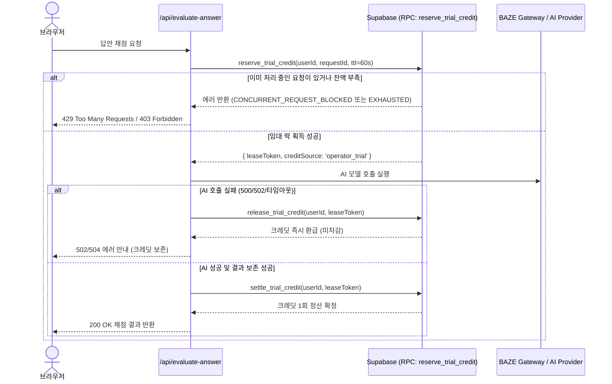

# Plan 05 — 05. AI 체험 크레딧 계층 정책, 개인 API 키 분리 및 어뷰징 방지 (Credit Tiers, Personal Key & Abuse Protection)

## 1. 개요 및 정책 목표
운영자가 제공하는 AI 체험 크레딧은 신규 사용자가 LearnAway의 대학 수준 채점 및 개념 분석 품질을 무상으로 경험할 수 있도록 돕는 온보딩 수단이다.
반면, 운영 비용의 무제한 팽창을 방지하고 상습적인 계정 재생성이나 악의적인 스크립트 호출을 차단하기 위해 엄격한 크레딧 계층 정책과 서버 사이드 보안 펜싱을 적용한다.

---

## 2. 계정 유형별 AI 체험 크레딧 정책 (Credit Tiers)

| 계정 유형 | 최초 지급 크레딧 | 1회 호출 시 차감 | 최대 소진 후 동작 | 개인 키 설정 시 |
| :--- | :--- | :--- | :--- | :--- |
| **게스트 (Guest)** | **1회** | 1 크레딧 | 소진 시 간편 회원가입 유도 (`403 FORBIDDEN`) | 개인 키 사용 가능 |
| **일반 회원 (Authenticated)** | **3회** (게스트 전환 시 잔여분 합산, 총 3회) | 1 크레딧 | 소진 시 개인 API 키 입력 안내 모달 | 개인 키 사용 시 차감 0회 |
| **개인 API 키 사용자** | 무관 (운영자 크레딧 불필요) | **0 크레딧** (차감 없음) | 무제한 이용 (사용자 본인 과금) | 운영자 크레딧 영구 보존 |

### 2.1 게스트 $\to$ 일반 회원 전환 시 중복 지급 방지
- 게스트 상태에서 1회를 소진한 후 일반 회원으로 가입하는 경우, 초기 크레딧은 2회(3 - 1)만 추가 지급되어 총 무료 이용 횟수가 3회를 초과하지 않도록 DB 수준에서 원자적으로 계산된다.

---

## 3. 개인 API 키 보안 및 격리 (Personal Key Isolation)

1. **클라이언트/로그 노출 원천 차단**:
   - 학생이 입력한 OpenAI/DeepSeek 개인 API 키는 클라이언트 번들이나 공용 로그에 절대 출력되지 않는다.
   - 서버 DB에 보존할 경우 AES-256-GCM으로 암호화 저장하거나, 클라이언트 세션 헤더(`x-personal-api-key`)를 통해 암호화 전송 후 즉시 폐기한다.
2. **0 크레딧 차감 보장 (Zero Operator Deduction)**:
   - 유효한 개인 API 키가 감지되면 `creditSource: 'personal_key'`로 설정되며, DB의 `user_trial_credits` 테이블을 일체 건드리지 않는다.
   - 모의시험 일괄 채점(5~10문항 동시 채점) 등 대량 호출 기능은 운영자 크레딧 대상에서 제외되며 반드시 개인 API 키를 요구한다.

---

## 4. 동시성 임대 락 및 펜싱 토큰 (Lease Locking & Fencing Tokens)

네트워크 지연이나 더블 클릭으로 인해 동일한 요청이 중복 제출되어 크레딧이 중복 차단되거나 AI가 중복 호출되는 문제를 방지하기 위해 펜싱 토큰 메커니즘을 적용한다:

- **임대 만료 시간 (TTL)**: 60초가 지나면 락이 자동 만료되어 불의의 서버 크래시에도 영구 데드락이 발생하지 않는다.
- **`STALE_LEASE_TOKEN` 방어**: 작업 시간이 초과되어 이미 다른 요청에 의해 회수된 임대 토큰으로는 정산 및 결과 저장이 거부된다.
- **결과 저장 실패 시 크레딧 정산 보류**: AI 응답이 정상 도착했더라도 DB 저장 또는 로컬 캐시 저장이 실패하면 크레딧을 차감하지 않고 환급(`release`)하여 학생의 권리를 보호한다.

---

## 5. 입력 상한 및 비상 차단 (Emergency Shutoff & Guardrails)

1. **입력 크기 상한 (Input Size Caps)**:
   - PDF 파일 크기: 최대 30MB
   - PDF 페이지 수: 최대 100페이지
   - 학생 서술형 답안 길이: 최대 10,000자
   - 악의적인 프롬프트 인젝션 및 초거대 토큰 소모 공격을 입력 수신 단계에서 즉시 `413 Payload Too Large`로 차단.
2. **운영자 비상 차단 스위치 (Emergency AI Shutdown)**:
   - 환경변수 `EMERGENCY_AI_SHUTDOWN=true` 또는 관리자 긴급 플래그 설정 시, 모든 운영자 크레딧 기반 AI 호출을 즉시 중단하고 `503 Service Unavailable (AI 서비스가 점검 중입니다)` 안내를 반환.
   - 개인 API 키 사용자의 자체 호출은 비상 스위치와 무관하게 정상 이용 가능.
