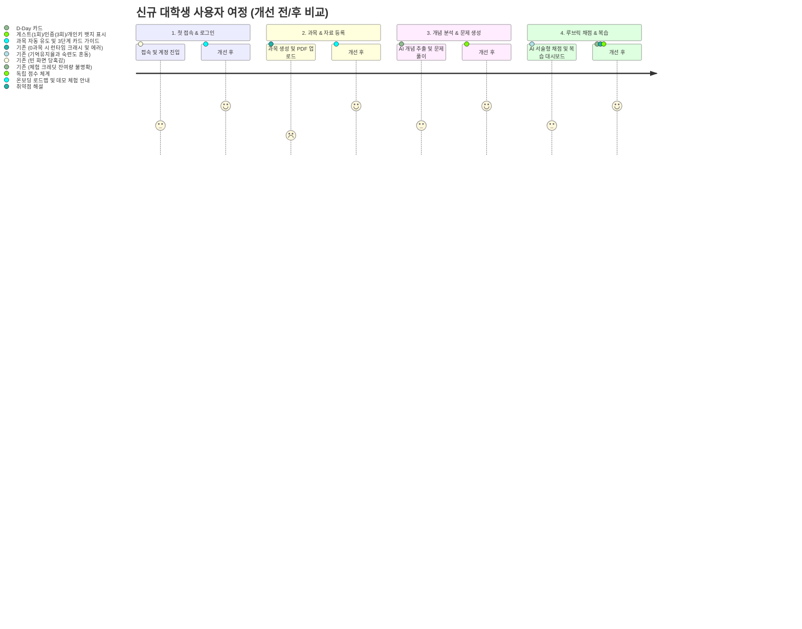

# Plan 06 — 01. UX 진단 및 사용자 여정 분석 (UX Audit & Journey Map)

## 1. 개요 및 진단 배경
LearnAway는 대학생의 전공 시험(수학, 통계학, 컴퓨터과학, 공학 등) 대비를 지원하는 전문 학습 SaaS이다.
기존 Plan 01~05를 거치며 데이터 동기화 안정성, 분산 스토리지 격리, AI 운영 비용 계측 등 강력한 백엔드·엔진 기반이 구축되었으나, UI/UX 관점에서 신규 접속 대학생이 겪는 사용성 장벽과 인지 부하(Cognitive Load)가 존재하였다.

본 문서는 신규 대학생의 첫 진입부터 복습 계획 확인까지의 여정을 정밀 감사(UX Audit)하고, 식별된 핵심 문제점 및 우선순위 개선 방향을 정리한다.

---

## 2. 기존 사용자 여정 및 장애 요인 (Friction Points)

### 2.1 주요 식별 결함 및 근본 원인 (Root Cause Analysis)

| 영역 | 식별된 문제점 (Issue) | 근본 원인 (Root Cause) | 개선 조치 (Action Taken) |
| :--- | :--- | :--- | :--- |
| **초기 진입** | 과목이 0개인 신규 사용자 접속 시 화이트스크린(Crash) 발생 | `activeSubject.name`, `activeSubject.id`에 대한 Null-Safety 결여 | `activeSubject?: Subject \| null` 타입 가드 및 `<OnboardingFlow>` 렌더링 |
| **온보딩** | 첫 접속 시 무엇을 먼저 해야 하는지 모름 | 텅 빈 대시보드와 가이드라인 부재 | 6단계 시각화 온보딩 로드맵 및 3단계 빈 상태(Empty State) 카드 도입 |
| **샘플 체험** | 자료가 없는 상태에서 시스템 기능을 즉시 경험하기 어려움 | 초기 데모 데이터셋 복원 CTA 부재 | '샘플 과목 및 강의자료 불러오기' 원클릭 액션 버튼 제공 |
| **AI 크레딧** | 내가 무료 체험 중인지, API 키를 쓰는지 구분 불가 | 단순 텍스트 크레딧 표기 및 계정 유형 미반영 | 게스트(1회)/인증학생(3회)/개인키(무제한) 뱃지 시각화 |
| **개념/문제** | 개념이 없는 상태에서 문제 탭 이동 시 맹목적인 목록 표시 | 상호 의존성(자료 $\to$ 개념 $\to$ 문제) 설명 부재 | '강의 자료 등록 및 개념 분석 필요' 사전 안내 배너 배치 |
| **운영 지표** | 운영자가 실제 토큰 비용 및 이상 호출을 모니터링하기 어려움 | 관리자 전용 UI 누락 | 4대 KPI 요약 및 토큰/비용/이상치 탐지 모달(`AdminAiMetricsModal`) 구현 |

---

## 3. 핵심 사용자 페르소나 및 목표 (User Personas)

### 페르소나 A: 공학/자연계열 시험 2주 전 대학생 (민우, 22세)
- **상황**: 미적분학 및 컴퓨터알고리즘 기말고사를 앞두고 수백 쪽의 PDF 강의노트와 필기 보유.
- **요구사항**: 복잡한 설정 없이 PDF를 올리고, 시험에 나올만한 고난도 증명·서술형 문제를 뽑아 풀고 싶음.
- **UX 니즈**: D-Day가 한눈에 보이고, 오늘 꼭 풀어야 할 취약 개념 복습 항목이 직관적으로 추천되어야 함.

### 페르소나 B: 게스트로 빠르게 기능을 맛보고 싶은 학생 (서연, 20세)
- **상황**: 회원가입 전 서비스가 대학 시험 수준의 고난도 문제를 잘 만들어주는지 1회 체험 희망.
- **요구사항**: 복잡한 API 키 발급 없이 무료 체험으로 즉시 문제 생성 및 AI 채점 경험.
- **UX 니즈**: 1회 남았음이 명확히 표시되고, 체험 후 정식 로그인 시 데이터가 보존되어야 함.

---

## 4. 우선순위 개선 원칙 (Design Principles)

1. **Zero-Instruction Onboarding (무설명 사용성)**:
   - 툴팁이나 긴 매뉴얼 없이 UI 컴포넌트의 배치와 다음 단계 유도(CTA)만으로 워크플로우를 완주할 수 있어야 한다.
2. **Crash-Free Null Safety (절대적 무결성)**:
   - 데이터가 완전히 비어 있는 상태(0 과목, 0 자료, 0 개념, 0 문제)에서도 모든 탭이 우아하게 빈 상태를 안내해야 한다.
3. **Transparent AI Telemetry & Credit (투명한 크레딧 및 계측)**:
   - 학생에게는 잔여 크레딧의 명확한 출처와 잔여 횟수를 제공하고, 운영자에게는 USD/KRW 비용 및 토큰 소모량을 투명하게 제공한다.
4. **Academic Terminology Consistency (학술 용어 표준화)**:
   - 대한민국 대학 교육 환경에 부합하는 학술 오류 체계(계산 실수, 개념 오류, 조건 누락 등)와 5단계 난이도 체계를 일관되게 적용한다.
