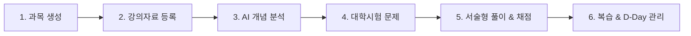

# Plan 06 — 02. 신규 사용자 온보딩 및 빈 상태 UX (Onboarding & Zero-State UX)

## 1. 개요
신규 학생이 가입하거나 게스트 모드로 처음 접속했을 때 가장 빈번하게 이탈하는 원인은 **"다음에 무엇을 해야 하는가?"**에 대한 안내 부재와 **"내 과목이 없을 때의 런타임 오류"**였다.
Plan 06에서는 전용 온보딩 컴포넌트(`<OnboardingFlow>`)를 구축하고, 0개 데이터 상태를 완전히 방어하는 3단계 빈 상태 로드맵을 구현하였다.

---

## 2. 6단계 엔드투엔드 온보딩 로드맵

신규 학생은 대시보드 진입 즉시 시각화된 6단계 학습 여정을 확인한다:

### 2.1 단계별 세부 가이드
1. **과목 생성**: 시험일(`examAt`)과 목표 점수를 입력하여 나만의 학기 과목 설정.
2. **강의자료 등록**: PDF 강의노트, 수업 필기 텍스트 파일(.txt/.md) 등록 (PDF 20MB / 텍스트 10MB 한도).
3. **AI 개념 분석**: 목차와 핵심 정리를 대학 수준의 개념 단위(`Concept`)로 자동 구조화.
4. **대학시험 문제**: 단순 암기형이 아닌 전공 시험 수준(증명, 복합 추론, 계산 전개)의 문항 생성.
5. **서술형 풀이 & AI 루브릭 채점**: 과정 중심 부분점수(70~90%) 및 학술 오답 9대 분류 진단.
6. **복습 & D-Day 관리**: 에빙하우스 망각곡선 기반 추천일과 시험 D-Day 맞춤 일정 확인.

---

## 3. 계정 유형별 AI 체험 크레딧 정책 및 시각화

학생이 시스템을 사용할 때 혼란을 방지하기 위해 상단 유틸리티 바(`TopUtilityBar`)와 온보딩 카드에 배지를 명확히 표시한다:

| 계정 유형 | 최초 지급량 | 1회 호출 시 소진 | 초과 시 동작 | UI 배지 표기 |
| :--- | :--- | :--- | :--- | :--- |
| **게스트 (비회원)** | **1회** | 1회 차감 | 로그인 유도 모달 노출 | `게스트 체험 (1/1회)` (Amber 배지) |
| **인증 학생 (로그인)** | **3회** | 1회 차감 | 개인 API 키 입력 유도 | `체험 (N/3회)` (Blue 배지) |
| **개인 API 키 사용자** | **무제한** | 0회 (무과금) | 개인 키 할당량에 따름 | `내 API 사용 중` (Emerald 배지) |

### 3.1 크레딧 카드 안내 컴포넌트
`OnboardingFlow.tsx` 상단에는 학생의 현재 계정 및 크레딧 상태를 안내하는 전용 카드가 배치된다:
- 잔여 크레딧 횟수 및 계정 전환 시 데이터 보존 안내.
- 학교 BAZE Gateway의 고성능 `deepseek-v4.1-flash` 모델을 무료 지원하고 있음을 명시.

---

## 4. 원클릭 샘플 데이터 로더 (`resetToInitialDemoData`)

강의자료 PDF나 필기 텍스트를 지금 당장 가지고 있지 않은 학생이라도, 즉시 서비스의 핵심 가치를 체험할 수 있도록 샘플 데이터 로더를 제공한다:

- **포함 데이터**:
  - `INITIAL_SUBJECTS`: 거시경제학, 컴퓨터시스템 등 대학 대표 2개 과목.
  - `INITIAL_MATERIALS`: 중간고사 시험범위 강의자료 메타 및 본문.
  - `INITIAL_CONCEPTS`: IS-LM 모형, 가상 메모리 등 핵심 전공 개념 4개.
  - `INITIAL_PROBLEMS`: 대학 시험 수준의 5단계 학술 난이도 및 서술형 루브릭 문항 4개.
- **실행 메커니즘**:
  - 버튼 클릭 시 `resetToInitialDemoData()`가 호출되어 로컬 스토리지 무결성을 검증하고 즉시 첫 번째 샘플 과목으로 화면을 전환한다.

---

## 5. 핵심 개념 FAQ: 기억 유지율 vs 개념 숙련도

학생들이 대시보드 지표를 보며 겪는 가장 흔한 의문을 온보딩 하단 FAQ에 친절하게 해설한다:

> **Q. 기억 유지율(Retention)과 개념 숙련도(Mastery)는 어떻게 다른가요?**
>
> - **기억 유지율 (0~100%)**: 시간에 따라 자연스럽게 감소하는 **망각곡선 기반의 추정치**입니다. 문제를 100점 맞았더라도 며칠간 복습하지 않으면 수치가 내려가며, 복습 권장 시점을 알려줍니다.
> - **개념 숙련도 (0~100점)**: 실제로 푼 문제의 난이도, 서술형 루브릭 점수, 학술 오류 발생 여부에 따른 **진짜 실력 지표**입니다. 시간이 지나도 저절로 깎이지 않으며, 오직 새로운 풀이 결과로만 갱신됩니다.
