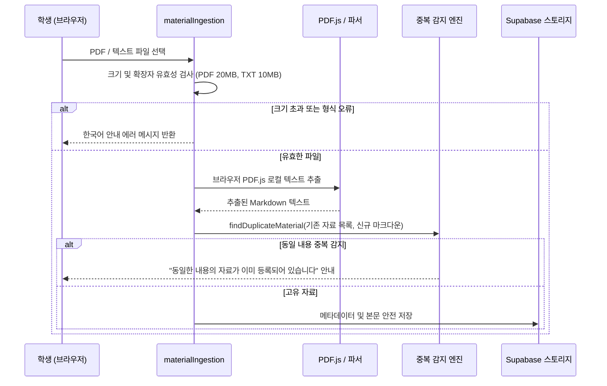

# Plan 06 — 04. 학습 워크플로우 완결성 (End-to-End Study Workflow)

## 1. 개요
대학생 중심 학습 도구로서 LearnAway의 성패는 **"자료 등록 $\to$ 개념 분석 $\to$ 문제 풀이 $\to$ 루브릭 평가 $\to$ 복습 스케줄"**로 이어지는 핵심 학습 루프가 얼마나 끊김 없고 안전하게 동작하느냐에 달려 있다.
본 문서는 이 워크플로우의 각 단계별 구현 세부사항과 데이터 보호 메커니즘을 상술한다.

---

## 2. 강의자료 등록 및 검증 (`materialIngestion.ts`)

### 2.1 파일 규격 및 중복 방지
- **입력 제한**: PDF는 최대 20MB (`pdfBytes`), 텍스트(.txt/.md)는 최대 10MB (`textBytes`).
- **정규화 비교**: `normalizeContentForComparison`을 통해 줄바꿈(`\r\n` $\to$ `\n`) 및 공백을 정규화한 후 기등록 자료와 일치 여부를 대조하여 중복 업로드를 방지한다.
- **클라이언트 우선 파싱**: 서버리스 비용 절감 및 프라이버시 보호를 위해 1차적으로 브라우저 내 PDF.js를 통해 텍스트를 파싱하고, 수식/복합 레이아웃 필요 시에만 외부 정밀 변환 백엔드로 안전하게 전환한다.

---

## 3. 임시 답안 보호 체계 (`practiceAnswerDraft.ts`)

학생이 대학 시험 수준의 긴 수식 전개와 서술형 증명 답안을 작성하던 중, 브라우저 새로고침이나 탭 이동, 실수로 인한 창 닫힘으로 인해 답안을 잃어버리는 불상사를 방지한다.

### 3.1 탭 격리 임시 저장소 (Per-Tab Draft Isolation)
- **키 스키마**: `redcall_user_<userId>__practice_answer_drafts_v1__<problemId>__v<version>__<tabId>`
- **다중 탭 지원**: 같은 문제를 두 개 이상의 탭에서 열어 서로 다른 답안을 작성하더라도, 탭 ID(`tabId`) 기반으로 격리되어 서로의 내용을 덮어쓰지 않는다.
- **자동 복원**: 해당 문제로 돌아왔을 때 작성 중이던 답안 텍스트, 풀이 이유, 신뢰도(1~5점)를 즉시 복원한다.
- **제출 시 정리**: 답안이 정식으로 제출(`Attempt` 생성 완료)되면 해당 탭의 임시 답안을 원자적으로 삭제(`clearPracticeAnswerDraft`)하여 유령 답안이 남지 않도록 한다.

---

## 4. 서술형 루브릭 채점 및 학술 오답 9대 분류 체계

LearnAway의 AI 평가는 단순 OX 채점이 아닌, 대학 전공 시험 루브릭 기준을 철저히 따른다:

| 오답 범주 (`AcademicErrorType`) | 한국어 레이블 | 대학 시험 평가 기준 |
| :--- | :--- | :--- |
| `NO_ERROR` | 오류 없음 | 완벽한 전개 및 올바른 최종 결론 (100점) |
| `CALCULATION_ALGEBRAIC` | 계산/대수 전개 실수 | 핵심 수식 및 원리는 타당하나 산술/부호 착오 (부분점수 70~85%) |
| `CONCEPT_CONFUSION` | 개념 혼동/원리 오적용 | 다른 정리나 부적절한 정의를 오적용하여 전개 (부분점수 30~50%) |
| `CONDITION_OMISSION` | 조건 누락/경계값 간과 | 수렴 조건, 정의역, 가역성 조건 누락 (부분점수 60~75%) |
| `LOGICAL_LEAP_PROOF` | 논리 비약/증명 불완전 | 핵심 중간 단계 미입증, 동어반복 전개 (부분점수 50~70%) |
| `INTERPRETATION_APPLICATION` | 문제 해석 오류/조건 미반영 | 문제에서 주어진 전제 조건을 반대로 해석함 (부분점수 20~40%) |
| `INSUFFICIENT_RIGOR` | 서술 불충분/엄밀성 부족 | 직관적 서술에 그치고 수학적 엄밀성이 결여됨 (부분점수 60~80%) |
| `TERMINOLOGY_NOTATION` | 학술 용어/표기법 오류 | 표준 기호 오용, 차원 불일치 (부분점수 80~90%) |
| `UNANSWERED_INCOMPLETE` | 미작성/답안 미완성 | 풀이가 중간에 중단되거나 백지 제출 (0~20점) |
| `UNCERTAIN` | 판정 보류/기타 | AI 신뢰도 부족으로 교수자 확인 권장 |

---

## 5. 복습 엔진의 일정 조정과 점수 불변성 (Schedule Invariance)

학생이 시험 일정 변경이나 개인 사정으로 복습 일정을 연기할 때(`postponeConceptReview`), 학술 데이터 무결성을 보장하는 핵심 불변 조건(Invariant)이 작동한다:

1. **점수 불변**: 복습을 연기해도 개념의 기본 점수(`baseScore`)와 현재 점수(`currentScore`)는 절대 인위적으로 상승하거나 왜곡되지 않는다.
2. **가짜 이력 금지**: 실제 학생이 문제를 풀어본 것이 아니므로 `ReviewEvent`나 `Attempt` 기록을 절대 조작하여 생성하지 않는다.
3. **오프셋만 반영**: 오직 스케줄 연기 일수(`postponeDays`)와 대상 일자(`postponedUntil`)만 안전하게 갱신된다.
