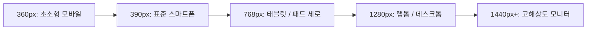

# Plan 06 — 05. 반응형 웹 및 웹 접근성 시맨틱 규격 (Responsive & Accessibility Standards)

## 1. 반응형 레이아웃 및 브레이크포인트 규격

대학생들은 강의실, 도서관, 대중교통 등 다양한 환경에서 스마트폰, 아이패드, 노트북을 오가며 학습한다.
LearnAway는 다음 5대 반응형 뷰포트에서 완벽한 레이아웃 무결성을 유지하도록 구축되었다:

### 1.1 브레이크포인트별 적응형 UI 동작

| 뷰포트 폭 | 기기 대표군 | 내비게이션 및 레이아웃 처리 | 핵심 최적화 |
| :--- | :--- | :--- | :--- |
| **360px** | Galaxy S/A 시리즈 | 상단 단일 헤더 + 햄버거 메뉴 드로어, 1열 카드 | 최소 터치 영역 44px 보장, 텍스트 줄바꿈 방지 |
| **390px** | iPhone 14/15/16 | 상단 단일 헤더 + 모바일 드로어 메뉴 | 수식 가로 스크롤 허용, 바텀 여백 확보 |
| **768px** | iPad, Galaxy Tab | 2단 그리드(D-Day + 오늘의 과제 분할), 상단 바 탭 | 분할 뷰 및 드래그 스크롤 지원 |
| **1280px** | MacBook, 14인치 랩톱 | 고정 좌측 사이드바 + 3단 대시보드 그리드 | 넓은 문제 풀이 에디터 및 루브릭 비교 뷰 |
| **1440px+** | 27인치 이상 외장 모니터 | `max-w-7xl` 중앙 집중형 컨테이너 | 과도한 가로 늘어남 방지 및 최적 가독선 폭 유지 |

---

## 2. 웹 접근성 (WCAG 2.2 AA) 준수 명세

대학 내 시각 장애, 색각 이상 또는 일시적 운동 장애가 있는 학생도 차별 없이 학습할 수 있도록 WCAG 2.2 Level AA 기준을 충족한다.

### 2.1 명도 대비 (Contrast Ratio)
- **일반 본문 텍스트**: 배경 대비 **4.5:1 이상** 준수 (`text-slate-900` on `bg-white`, `text-slate-100` on `bg-slate-900`).
- **굵은 텍스트 및 제목 (18pt / 24px 이상)**: 배경 대비 **3.0:1 이상** 준수.
- **상태 배지**:
  - D-Day D-7 이내: Amber 계열 고대비 경보 (`bg-amber-100 text-amber-900` on Light, `bg-amber-950 text-amber-300` on Dark).
  - 위험/취약 개념: Red 계열 고대비 경보 (`bg-rose-100 text-rose-900`).
  - 안정/완료: Emerald 계열 고대비 (`bg-emerald-100 text-emerald-900`).

### 2.2 키보드 접근성 및 포커스 관리 (Keyboard Operability)
- **모달 대화상자**: `<AdminAiMetricsModal>` 진입 시 `Escape` 키로 즉시 닫히며, 포커스가 모달 내부에 트랩(Trap)되어 배경 탭 이동을 방지한다.
- **포커스 링**: 모든 상호작용 요소(버튼, 입력 필드, 탭)는 `focus-visible:ring-2 focus-visible:ring-indigo-500 focus-visible:ring-offset-2` 스타일을 적용하여 현재 초점 위치를 명확히 보여준다.
- **키보드 탭 전환**: 상단 워크스페이스 탭(`Today`, `Materials`, `Problems`, `History`, `Settings`)은 `Tab` 및 `Enter/Space` 키로 온전히 전환 가능하다.

### 2.3 시맨틱 HTML 및 ARIA 속성 (Semantics & ARIA)
- 모달 대화상자: `role="dialog"`, `aria-modal="true"`, `aria-labelledby="modal-title"`
- 버튼 상태 토글: `aria-expanded="true/false"`, `aria-haspopup="true"`
- 로딩 상태: `aria-busy="true"`, `aria-live="polite"`
- 시맨틱 랜드마크: `<header>`, `<nav>`, `<main>`, `<section>`, `<footer>` 적재적소 분할.

---

## 3. 한국어 학술 타이포그래피 및 가독성

- **글꼴 체계**: 시스템 폰트 및 고딕 계열(`font-sans`)을 최우선으로 적용하여 수식 기호와 한글 조합 시 베이스라인 깨짐을 방지한다.
- **행간 (Line Height)**: 긴 학술 문제와 루브릭 해설의 가독성을 위해 `leading-relaxed`(1.625)를 표준으로 채택한다.
- **수식 렌더링**: KaTeX 수식 블록(`$$...$$`) 및 인라인 수식(`$...$`)에 `overflow-x-auto`를 적용하여 360px 모바일 화면에서도 컨테이너를 뚫고 나가지 않도록 가로 스크롤을 제공한다.
