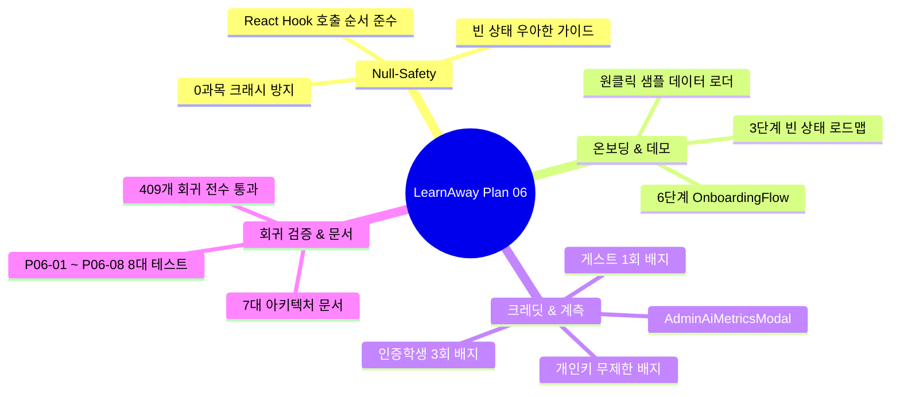

# Plan 06 — 07. Plan 07 인계 및 대학생 실사용 테스트 가이드 (Handoff to Plan 07)

## 1. Plan 06 완료 산출물 총괄 요약

Plan 06에서는 대학생이 서비스에 처음 접속하더라도 별도 설명서 없이 자율적으로 학습을 완주할 수 있도록 UX/UI 전반을 고도화하였다.

---

## 2. 실제 대학생 사용자 테스트 시나리오 (User Testing Scenarios)

### 시나리오 1: 기말고사 10일 전 신규 학생의 첫 진입 (Zero-Instruction)
1. **상황**: 미적분학 기말고사를 대비하려는 자연대 1학년 학생이 브라우저로 첫 접속.
2. **기대 행동**:
   - 빈 대시보드 대신 `<OnboardingFlow>`의 6단계 로드맵 확인.
   - '샘플 과목 불러오기' 또는 '새 과목 만들기'를 직관적으로 선택.
   - 상단에서 '게스트 체험 (1/1회)' 배지를 확인하고 안심하고 체험 시작.
3. **성공 기준**: 첫 진입 후 3분 이내에 문제 1개를 풀고 AI 루브릭 평가 결과까지 확인 완료.

### 시나리오 2: 작성 중 브라우저 실수 종료 및 답안 복구 (Draft Safety)
1. **상황**: 복합 수식 전개 답안을 5분간 작성하다가 실수로 브라우저 탭을 닫음.
2. **기대 행동**:
   - 다시 브라우저를 열고 해당 문제 탭으로 이동.
   - 작성 중이던 답안 텍스트, 풀이 이유, 신뢰도(5점)가 100% 온전하게 복원되어 있음.
3. **성공 기준**: 답안 유실 없이 즉시 '답안 제출'을 완료할 수 있음.

---

## 3. 핵심 UX 텔레메트리 지표 (Product Telemetry Metrics)

Plan 07 및 향후 제품 운영 시 모니터링해야 할 핵심 정량 지표는 다음과 같다:

1. **온보딩 완주율 (Onboarding Completion Rate)**:
   - 신규 접속 세션 중 '과목 생성 $\to$ 자료 등록 $\to$ 문제 풀이 $\to$ 채점'까지 도달한 비율 (목표: > 65%).
2. **첫 문제 풀이 도달 시간 (Time-to-First-Practice, TTFP)**:
   - 첫 접속부터 첫 번째 서술형 문제 제출까지 소요된 시간 (목표: < 5분).
3. **체험 크레딧 전환율 (Trial-to-Auth Conversion Rate)**:
   - 게스트 1회 체험 완료 후 정식 회원가입 및 로그인으로 전환된 비율 (목표: > 40%).
4. **모바일 뷰포트 오류율 (Mobile Error Rate)**:
   - 360px~390px 모바일 접속 시 발생하는 레이아웃 오버플로우 및 크래시 비율 (목표: 0.0%).

---

## 4. Plan 07로의 확장 인계 항목 (Roadmap to Plan 07)

Plan 06의 탄탄한 프론트엔드 UX 기반 위에, Plan 07에서 추가 확장이 권장되는 영역은 다음과 같다:

1. **PWA 오프라인 캐싱 및 백그라운드 동기화**:
   - 도서관 지하 등 통신 음영 지역에서도 캐시된 문제 풀이 및 IndexedDB 답안 저장이 완전하게 유지되는 Service Worker PWA 구축.
2. **LaTeX 수식 실시간 라이브 프리뷰 에디터**:
   - 대학 수학/물리 전공생을 위한 모달 분할 라이브 KaTeX 수식 편집기 도입.
3. **스터디 그룹 및 교수자 맞춤 루브릭 공유**:
   - 같은 강의를 수강하는 학우 간 문제 세트 공유 및 교수자 루브릭 템플릿 커스텀 기능.
4. **알림 채널 다변화 (Web Push / 카카오 알림톡)**:
   - D-Day D-3 및 당일 복습 알림을 브라우저 Web Push 및 모바일 메신저로 전송.
